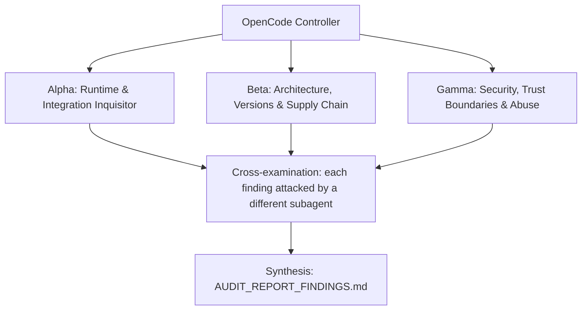

# ADVERSARIAL THREE-SUBAGENT AUDIT PROMPT: `agency-control-plane`

**Target Codebase**: the Git repository this file sits in. Resolve it with `git rev-parse --show-toplevel` and treat every path below as relative to that root. Nothing in this prompt depends on where the checkout lives.
**GitHub Remote**: `https://github.com/Heretek-AI/agency-control-plane`
**What it is supposed to be**: the Fleet Dispatcher daemon plus a high-fidelity WebUI: a Kanban board, a top-level Director chat backed by a long-lived OpenCode session, task drill-down, side-by-side diff review, and 1-click Ed25519 human approval against a pinned human key (compatible with `epistemic-factory` es-core). It spawns headless `opencode serve` workers in isolated git / `jj` worktrees, lands approved work, and fails over across three model tiers. Blueprint refusal boundary: orchestration and WebUI only, never coding tools, AST parsers or domain skills. Budget: 3,000 to 5,000 LOC.
**Execution Context**: OpenCode v2 autonomous audit (works the same in any agent CLI that has subagents and a shell)
**Auditor Formation**: three independent adversarial subagents (Alpha, Beta, Gamma), a cross-examination pass, and a synthesis pass
**Output**: `AUDIT_REPORT_FINDINGS.md` at the repository root

This prompt is designed to be re-run. Each run audits the current `HEAD`, re-verifies every finding of the previous run, and overwrites `AUDIT_REPORT_FINDINGS.md`.

---

## 0. Preflight (the controller does this before spawning subagents)

1. **Baseline.** Record at the top of the report: `git rev-parse HEAD`, `git log -1 --format='%ci %s'`, the UTC date, and the versions of every tool you will use (`bun`, `node`, `git`, `jj` if present, `nats-server`, Chromium for `playwright-core`, `rg`, `jq`, and the `anomalyco/opencode` commit you compare against). If `git status --porcelain` shows changes other than this prompt file and a previous report, list the dirty files and audit a clean `git worktree` of `HEAD` instead of the working tree.
2. **Scratch space.** `export AUDIT_TMP="$(mktemp -d -t agency-control-plane-audit-XXXXXX)"`. Every clone, downloaded binary, packed tarball, sabotage copy, container volume and raw log goes under `$AUDIT_TMP`. Each subagent writes its raw notes to `$AUDIT_TMP/{alpha,beta,gamma}.md`.
3. **Disposable copy for experiments.** `git worktree add --detach "$AUDIT_TMP/wt" HEAD`. Sabotage, patched configs, and any file edits happen only there. The real checkout must end the audit with `git status --porcelain` showing nothing new but `AUDIT_REPORT_FINDINGS.md` (and this prompt file, if you copied it in untracked). Remove the copy with `git worktree remove --force "$AUDIT_TMP/wt"` at the end.
4. **Previous run.** If `AUDIT_REPORT_FINDINGS.md` already exists, read it before anything else. Every finding in it gets a row in the Regression Ledger (section 6), re-verified from scratch: never copy a previous verdict forward.
5. **Network and host capabilities.** You need outbound HTTPS to github.com, raw.githubusercontent.com, registry.npmjs.org, api.github.com, and the Go module proxy (for `nats-server`). Probe what this host can do (`bun --version`, `git --version`, `jj --version`, `nats-server --version`, whether Chromium launches, whether an OpenCode v2 binary can be built or installed) and record it. When a check cannot run here, the claim is `UNVERIFIABLE` with the exact reason. A claim is never `VERIFIED` by inference, by reading the code alone, or because a test says so.

**Hard limits (all subagents):** no `npm publish`, no `git push`, no tags, no GitHub writes (issues, comments, PRs), no real API keys or credentials in any command, file or report (generate throwaway keys and dummy values), no destructive command outside `$AUDIT_TMP`, and never point `--repo` at the real checkout: use a throwaway repository under `$AUDIT_TMP`. Read-only against the real checkout.

---

## 1. Directive & Rules of Engagement

You are a team of **three elite, adversarial principal systems auditors**. Your mandate is to stress-test, debunk, and verify every claimed feature, architectural decision, integration contract, security invariant, and version pin in **`agency-control-plane`**, measured against what the repository is supposed to be (above) and what its own `README.md`, `AGENTS.md` and `docs/` claim.

### The Cardinal Rule: DO NOT BELIEVE TESTS
- Unit tests, acceptance scripts (`make accept`, `scripts/accept/wave-*.sh`) and CI badges can lie: they assert obsolete invariants, mock away the real system, or test that a file *contains* a rule rather than that the rule *works*.
- This repository has a documented history of exactly that:
  - 93 tests passed while approvals could be forged (the server verified against a public key taken from the request body), no code spawned any worker, and the WebUI could not be bundled for a browser (`node:crypto` in browser code). The wave-3 drift guard reported "Findings: None".
  - The worker protocol is tested only against `dispatcher/test/fixtures/fake-opencode.ts`, a fake written by the same agents who wrote the client. Every route, event name and environment variable it implements is an unverified claim about OpenCode v2.
  - PR #3 (landing on approval, worktree release, role packs, tier fallback) is recent; its role pack layout was designed without any real role pack existing, and SonarCloud flagged a security item on it that nobody has looked at yet.
- Never conclude that a component works because `bun test` or `make accept` exits 0. Prove behavior against **the real thing it plugs into**: the real OpenCode v2 server (`opencode serve` from `anomalyco/opencode` `dev`: its HTTP routes, SSE events, env vars and config layout), real git and `jj` repositories, a real `nats-server`, a real Chromium, and `epistemic-factory`'s es-core signing code.

### The Second Rule: DO NOT BELIEVE THE PAPER TRAIL
- `docs/reports/*`, `docs/evidence/*`, "red-proof" logs, drift-guard `VERDICT: PASS` lines, `CHANGELOG.md`, and `README.md` are **claims under audit**, not evidence.
- The repo was built by agents from a self-contained prompt (`MASTER_BUILD_PROMPT.md` / `docs/prompts/SPEC.md`). That prompt contained invented facts (API names, image tags, config shapes), and the build gates only checked spec compliance. Matching the spec is not the same as working. Where the spec and reality disagree, reality wins and the spec is the defect.

### The Third Rule: SABOTAGE EVERY CRITICAL INVARIANT
- For each invariant marked **[S]** in section 3, break it with a one-line change in `$AUDIT_TMP/wt`, run the full suite there, and record whether the suite went red. Restore the line after each run.
- A sabotage the suite does not catch is a finding: **P1** ("untested invariant"), or **P0** when the invariant is a security boundary.

### Modern Version & Proper Deployment Imperative
- Every pinned version must be a **modern, supported, production-grade release that actually exists** in its registry. Flag invented versions, deprecated or archived packages, renamed organizations, floating tags (`latest`, `^` ranges on security-relevant deps, unpinned GitHub Actions), end-of-life runtimes, and versions with known CVEs (`npm audit`, OSV: `https://api.osv.dev/v1/query`).
- Verify that integration patterns follow the **official upstream documentation and source code** of the system being integrated, at the version pinned and at the current upstream head (drift is a finding).

### Verdict vocabulary
Every claim in section 3 ends with exactly one status, each backed by a command and its output:
- `VERIFIED` (proven to work against the real thing), `PARTIAL` (works with caveats you name), `BROKEN` (proven not to work), `UNVERIFIABLE` (could not be run here, with the exact reason).

---

## 2. The Adversarial Triad (Subagent Roles)



### Subagent Alpha: Runtime & Integration Inquisitor
* **Focus**: "Does the dispatcher really drive real OpenCode v2 workers end to end, or only the hand-written fake in `dispatcher/test/fixtures/fake-opencode.ts`?"
* **Methodology**:
  - Treat `fake-opencode.ts` as an unverified claim about upstream. For every route, request body, response field, SSE event name and payload field, environment variable and stdout line it implements, find the real definition in `anomalyco/opencode` `dev` (server routes, event bus, CLI `serve` command) and record match or mismatch with the upstream file and commit.
  - If a real OpenCode v2 binary can be built or installed here (from the upstream checkout: `bun install && bun run --cwd packages/opencode …`, or a published dev build), run the dispatcher with `--worker-cmd` and `--director-cmd` pointing at it and push one card through the whole flow with a cheap or mock provider. If it cannot be run, say exactly why and fall back to the source comparison.
  - Exercise the daemon for real with the fake worker: keygen, start, `/ship`, Director fenced `tasks` block (valid, unknown field, bad dep, invalid JSON), scheduling under caps, a signed approval made by your own script with the generated key, landing, a forced merge conflict, restart persistence, SIGTERM re-queue, worktree release and salvage refs.
  - Build the WebUI (`bun run build:web`) and load it in a real Chromium (`make e2e-ui`, or Playwright against `bun run serve`); check every pillar renders live data, not fixtures.

### Subagent Beta: Architecture, Versions & Supply Chain
* **Focus**: "Is this a sound, current, sustainable control plane, and does it fit the ecosystem it is supposed to orchestrate?"
* **Methodology**:
  - Check every pin against its registry and support status: `react`/`react-dom` 18.3.1 (React 19 is current), `@noble/hashes` 1.8.0 (2.x exists), `nats` 2.29.3 (the legacy nats.js v2 line vs the `@nats-io/*` v3 packages), `zod` 3.25.76, `playwright-core` 1.56.1, `typescript` 5.9.3, `@types/bun` 1.4.3, Bun 1.4.2, and in CI `nats-server` v2.10.24, Go 1.23, `oven-sh/setup-bun` v2.0.2.
  - Evaluate the architecture choices: single process with an in-memory ring buffer as SSE source of truth, `bun:sqlite` WAL with `busy_timeout=15000`, `jj` fallback, git worktrees per task, one long-lived Director session, NATS optional mirror.
  - Check ecosystem fit: role pack layout (`<roles-dir>/<role-id>/opencode/opencode.json`, `agent/`, `skill/`) against the real OpenCode v2 config directory layout and `XDG_CONFIG_HOME` resolution; whether any real role pack exists anywhere (the layout was designed without one); whether workers load `@heretek-ai/opencode-harness` and the router config; whether the "dispatcher activates compose profiles per card tag" step from the blueprint exists.
  - Measure scope against the `AGENTS.md` refusal boundary (no coding tools, AST parsers or domain skills) and the 3,000 to 5,000 LOC budget.

### Subagent Gamma: Security, Trust Boundaries & Abuse
* **Focus**: "Can anything other than the human holding the key approve, land, or exfiltrate work, and can a worker escape its worktree?"
* **Methodology**:
  - Approval forgery: mint tickets and try to sign with a key you generated, with a client-supplied public key or passphrase field, with a signature for another task, with a stale or reused ticket, after 60 s, with a `subjectHash` that differs from the server's, and by replaying an es-core `signStageApproval` record from `epistemic-factory` (stage names must be disjoint).
  - TOCTOU between approval and landing: change the task branch after the ticket is minted, and after signing but before the merge. The commit that lands must be exactly the one whose diff was signed.
  - Worker escape via Git: a worker has a shell inside a linked worktree whose common git dir is the dispatcher's repository. Check whether a worker can write `$(git rev-parse --git-common-dir)/hooks/*`, set `core.hooksPath` or other config (including `extensions.worktreeConfig`), or plant `.gitattributes` filters that later execute on the host during commit or landing.
  - Loopback is not a security boundary in a browser: check `Host` and `Origin` validation against DNS rebinding and cross-site requests to `127.0.0.1:7600`, the CSRF scheme, the CSP, and whether `/api/events` or `/api/board` leak data cross-origin.
  - Worker servers: is each `opencode serve` bound to `127.0.0.1`, protected by `OPENCODE_SERVER_PASSWORD` the way upstream actually enforces it, and is the password generated with a CSPRNG and kept out of logs, events and the audit ledger?
  - Injection: task keys, titles, paths, mission ids and role ids flowing into branch names, file paths, git arguments and prompts (`fleet/<task>`, `refs/fleet-salvage/<task>`, `<roles-dir>/<role-id>`).
  - Key handling: `keygen` file modes (0600), Security Invariant I1 in a real browser, audit ledger hash chain tamper detection, NATS without auth or TLS.

---

## 3. Comprehensive Inventory of Claimed Functions & Architectural Decisions

Owners: `[A]` Alpha, `[B]` Beta, `[G]` Gamma. `[S]` marks an invariant that must be sabotaged (Third Rule).

### Domain 1: Daemon & Configuration (`dispatcher/src/main.ts`, `cli-args.ts`)
* **Claim 1.1 [A]**: Every flag and env var in the README table (`--repo`, `--state-dir`, `--port`, `--human-pub`, `--worker-cmd`, `--director-cmd`, `--director-agent`, `--task-agent`, `--fleet-cap`, `--per-expert-cap`, `--roles-dir`, `--tier-models`, `--task-timeout-ms`, `--no-workers`, `--no-director`, `NATS_URL`) is parsed and has the documented effect and default.
* **Claim 1.2 [G][S]**: The server never binds anything but `127.0.0.1`.
* **Claim 1.3 [A][S]**: A missing or invalid human public key disables approvals and the approval routes answer 503 (fail closed); invalid `--tier-models` fails startup; `NATS_URL` set but unreachable fails startup.

### Domain 2: Worker Lifecycle Against OpenCode v2 (`opencode-client.ts`, `worker-session.ts`, `worker-launcher.ts`)
* **Claim 2.1 [A]**: Workers are spawned with `opencode serve --port 0 --hostname 127.0.0.1` and the dispatcher learns the URL from a `server listening on <url>` line that real OpenCode v2 prints.
* **Claim 2.2 [A]**: `OPENCODE_DB=<worktree>/.opencode/opencode.db` and `OPENCODE_SERVER_PASSWORD` are real OpenCode v2 settings with the assumed behavior.
* **Claim 2.3 [A]**: `POST /api/session`, `POST /api/session/:id/prompt` and `GET /api/event` exist in OpenCode v2 with the request and response shapes the client uses.
* **Claim 2.4 [A]**: The events `session.tool.*`, `session.status`, `session.text.ended`, `session.execution.succeeded|failed|interrupted` exist upstream with the payload fields the dispatcher reads.
* **Claim 2.5 [A][S]**: A successful run is committed onto `fleet/<task>` excluding `.opencode` state; a non-empty diff moves the card to Waiting Approval / QA, an empty one to Done; failures follow the retry policy; timeouts and process exits end the run.
* **Claim 2.6 [A]**: SIGINT/SIGTERM kills every worker process (no orphans: check with `ps`) and re-queues interrupted tasks.

### Domain 3: Director Chat (`director.ts`)
* **Claim 3.1 [A]**: Messages go to one long-lived OpenCode session using agent `director`, with its own isolated database, and the reply is shown in chat.
* **Claim 3.2 [A][S]**: Cards are created only from a fenced `tasks` block validated strictly with zod; unknown fields, bad deps or invalid JSON create nothing and are reported.
* **Claim 3.3 [A]**: `/ship <spec>` turns each bullet into one card without the Director; without a Director, non-`/ship` messages get 503.

### Domain 4: Scheduler (`scheduler.ts`, `wildcard.ts`)
* **Claim 4.1 [A][S]**: Dependencies with `all_success` / `one_success`, path-overlap serialization, the fleet cap and per-expert caps (including `role.json` `maxConcurrent`) are enforced.
* **Claim 4.2 [A]**: The scheduler is pure and deterministic for a given board.

### Domain 5: Worktrees, Landing & Release (`worktrees.ts`, `landing.ts`)
* **Claim 5.1 [A][S]**: Worktree allocation is two-phase and crash-safe (kill the daemon between phases and restart), pins the base commit, and falls back to `jj` when configured.
* **Claim 5.2 [A][S]**: APPROVE merges `fleet/<task>` with `--no-ff` into `fleet/integration/<mission>` in a throwaway worktree and records `landedSha`; a conflict leaves the integration branch untouched, returns 409 with the conflicting files, and keeps the task in Waiting Approval / QA.
* **Claim 5.3 [A][S]**: Tasks reaching `done`, `failed` or `cancelled` with no running worker have their worktree removed; branches of `failed`/`cancelled` tasks are anchored at `refs/fleet-salvage/<task>` before deletion; a restart releases worktrees of tasks that finished while the daemon was down.
* **Claim 5.4 [G]**: Nothing a worker writes inside its worktree can execute on the host during commit, landing or release (hooks, config, attributes filters).

### Domain 6: Cryptographic Human Approval (`approval-tickets.ts`, `human-key.ts`, `keygen.ts`, `web/src/security/approval-client.ts`)
* **Claim 6.1 [G][S]**: The server computes `subjectHash = sha256(concatenated per-file patches of base...fleet/<task>)`; no client-supplied hash, public key or passphrase is trusted.
* **Claim 6.2 [G][S]**: Tickets are single-use, expire after 60 s, and are bound to one task.
* **Claim 6.3 [G][S]**: Signatures verify only against the pinned `human.pub`; the signed payload is canonical JSON `{ runId, stage: "APPROVE" | "REJECT", subjectHash, timestamp }`.
* **Claim 6.4 [A][G]**: The key format and payload are compatible with `epistemic-factory` es-core `signStageApproval` / `verifyStageApproval`: a key sealed by `es key seal` works here, and a record signed here verifies with es-core (but cannot satisfy an es-core stage, and vice versa). Test against current `epistemic-factory` `main`, not only the stored fixture `dispatcher/test/fixtures/es-core-vector/`.
* **Claim 6.5 [G]**: The browser recomputes the hash from the diff it shows and refuses to sign on mismatch; it unlocks `human.key.enc` with scrypt (`@noble/hashes`) and AES-GCM + Ed25519 via WebCrypto; Security Invariant I1 holds in a real browser (no key bytes in stores, storage or DOM).
* **Claim 6.6 [G][S]**: The full signed record goes into the hash-chained audit ledger, and editing any ledger line is detected.

### Domain 7: Quota Limits & Tier Failover (`limits.ts`, `--tier-models`)
* **Claim 7.1 [A][S]**: Quota-shaped provider errors move the fleet to the next tier and re-queue the task without spending an attempt; a tier's quota exhaustion is counted once; quota on `tier-3-local` holds new launches until the provider's retry time; `Retry-After` is honored.
* **Claim 7.2 [A]**: New worker sessions run on the active tier's model from `--tier-models`, using a model selector the real OpenCode v2 session API accepts.

### Domain 8: Persistence, Event Bus, SSE & NATS (`board-store.ts`, `event-bus.ts`, `nats-bridge.ts`)
* **Claim 8.1 [A][S]**: Tasks, missions, chat, counters and tool logs survive a restart; running tasks are re-queued.
* **Claim 8.2 [A]**: SSE replays from `Last-Event-ID` and emits gap markers when the ring buffer has rolled over.
* **Claim 8.3 [A][B]**: With `NATS_URL`, events go to JetStream `fleet.events.<type>` on stream `FLEET_EVENTS` (drop-oldest at 10,000) and tasks mirror to KV `fleet-board`, against a current `nats-server`.

### Domain 9: WebUI (`web/`)
* **Claim 9.1 [A]**: `bun run build:web` produces a working browser bundle (no `node:` imports, no empty chunks) served by the dispatcher with a strict same-origin CSP.
* **Claim 9.2 [A]**: The five pillars work against live data: Kanban, Director chat, drill-down (session, gates, tool log, diff hunks), side-by-side diff, 1-click approval.

### Domain 10: Role Packs (`roles.ts`, `--roles-dir`)
* **Claim 10.1 [A][B]**: A role pack is copied (not symlinked) into the worktree `.opencode/`, its prompt has frontmatter stripped, its skills are listed, and `XDG_CONFIG_HOME=<roles-dir>/<role-id>` makes real OpenCode v2 load its agents and skills. `agents/` and `skills/` aliases work.
* **Claim 10.2 [G][S]**: Only slug role ids resolve (no traversal); an `expert` without a pack runs with the generic prompt and emits `role.missing`.

### Domain 11: Scope, CI & Ecosystem
* **Claim 11.1 [B]**: The repo stays inside its refusal boundary and LOC budget.
* **Claim 11.2 [B]**: CI runs `make check` and `make accept` (including the NATS integration test and the Chromium smoke test) on every PR, with third-party actions pinned to SHAs.
* **Claim 11.3 [B]**: The blueprint's seams owned by this repo exist: spawning `es` workers as well as `opencode serve`, and activating devcontainer compose profiles per card tag. Report each as present or missing.

---

## 4. Reality-Check Recipes

```bash
# Upstream truth for the worker protocol
git clone --depth 1 -b dev https://github.com/anomalyco/opencode "$AUDIT_TMP/opencode"
rg -n 'listening on|OPENCODE_SERVER_PASSWORD|OPENCODE_DB' "$AUDIT_TMP/opencode/packages" | head -40
rg -n '"/session"|/prompt|"/event"|session\.execution\.|session\.tool\.|session\.text\.ended|session\.status' "$AUDIT_TMP/opencode/packages" | head -80
rg -n 'XDG_CONFIG_HOME|"agent"|"skill"' "$AUDIT_TMP/opencode/packages/core/src" | head -40
# Compare each route/event/env in dispatcher/test/fixtures/fake-opencode.ts against the hits above.

# Run the daemon for real (fake worker if no real v2 binary)
bun install --frozen-lockfile --ignore-scripts
bun run keygen -- --out "$AUDIT_TMP/state"          # prompts for a throwaway passphrase
git init "$AUDIT_TMP/target" && git -C "$AUDIT_TMP/target" commit --allow-empty -m init
bun run dispatcher -- --repo "$AUDIT_TMP/target" --state-dir "$AUDIT_TMP/state" --port 7699 \
  --worker-cmd "[\"bun\",\"$PWD/dispatcher/test/fixtures/fake-opencode.ts\"]" &> "$AUDIT_TMP/logs/dispatcher.log" &
curl -s http://127.0.0.1:7699/api/board | jq '.columns | keys'
curl -s -H 'Host: evil.example' http://127.0.0.1:7699/api/board -o /dev/null -w '%{http_code}\n'   # DNS-rebinding probe
# Mint a ticket, sign with your own script (es-core-compatible payload), POST /sign, then try every forgery from Gamma.

# Cross-repo approval compatibility
git clone --depth 1 https://github.com/Heretek-AI/epistemic-factory "$AUDIT_TMP/factory"
# Seal a key with: (cd "$AUDIT_TMP/factory" && bun install && bun packages/cli/src/bin.ts key seal --key-dir "$AUDIT_TMP/eskey")
# and point --human-pub at "$AUDIT_TMP/eskey/human.pub".

# Registry and support status
for p in react react-dom @noble/hashes nats @nats-io/transport-node zod playwright-core typescript; do echo "== $p"; npm view "$p" version deprecated; done
curl -s https://api.github.com/repos/nats-io/nats-server/releases/latest | jq -r .tag_name
npm audit --json > "$AUDIT_TMP/logs/npm-audit.json" || true

# Browser bundle and UI
bun run build:web && rg -n 'node:' web/dist || echo "no node: imports in bundle"
make e2e-ui
```

Sabotage targets (`[S]`) at minimum: server-side `subjectHash` computation, ticket burn, ticket TTL, pinned-key verification, landing conflict handling, worktree release and salvage anchoring, `.opencode` exclusion from commits, Director block strictness, path-overlap serialization, tier failover counting, loopback bind, role id slug check, audit chain verification.

---

## 5. Execution Directives for OpenCode

1. **Independent exploration.** Spawn Alpha, Beta and Gamma concurrently as three separate subagents. Hand each one this entire file plus its role. They must not read each other's notes until step 4. Each one works through the claims it owns (ownership is marked `[A]`, `[B]`, `[G]` in section 3) and may file findings on any claim.
2. **Run things.** Prefer executing to reading. Use the recipes in section 4 and any further commands you need (`bun`, `node`, `npm view`, `npm pack`, `git ls-remote`, `curl`, `jq`, `rg`, `git`, `jj`, `nats-server`, Playwright/Chromium). Save the raw output of every command you cite under `$AUDIT_TMP/logs/`.
3. **Empirical Proof Mandate.** For every claim judged `BROKEN`, `PARTIAL`, insecure, or outdated, record:
   - the exact file path and line number (`path/to/file.ts:123`);
   - the exact command executed to prove it, runnable as written from the repository root;
   - the raw output, error message, or registry response (trimmed to the relevant lines, never paraphrased);
   - for upstream comparisons, the upstream file path and commit SHA you compared against.
4. **Cross-examination.** When all three are done, each finding is handed to a different subagent (Alpha's to Beta, Beta's to Gamma, Gamma's to Alpha), whose job is to refute it: re-run the proof, look for a misreading, a wrong upstream version, or an environment artifact. A refuted finding is dropped or downgraded, and the refutation is noted in the finding.
5. **Coverage gate.** Before synthesis, check that every claim ID in section 3 has a status. Any claim without one goes back to its owner.
6. **Synthesis.** The controller writes `AUDIT_REPORT_FINDINGS.md` in the structure below, then cleans up (`git worktree remove`, stop any containers or processes you started) and confirms the real checkout has no changes apart from the report and this prompt file.

---

## 6. Report Structure: `AUDIT_REPORT_FINDINGS.md`

```markdown
# AUDIT_REPORT_FINDINGS: agency-control-plane

## Baseline
Commit, commit date, audit date (UTC), tool versions, host capabilities, and the list of checks that could not run here and why.

## Verdict
Three to six sentences: does `agency-control-plane` do what it is supposed to be, against the real systems it plugs into? Name the single most important thing to fix.

## Prioritized Defect Matrix
| ID | Priority | Claim | Location | Summary |
|----|----------|-------|----------|---------|

## Findings
### ACP-<claim-id>-<slug>: <title>
- **Priority:** P0 | P1 | P2 | P3
- **Claim:** <claim ID and text>
- **Location:** `path:line`
- **Proof:** the command(s), runnable from the repo root
- **Raw output:** fenced block, trimmed, verbatim
- **Why it matters:** one or two sentences, in terms of what breaks for a user
- **Remediation:** an exact, fail-closed diff or command sequence
- **Verify the fix:** the command that goes from failing to passing once fixed
- **Cross-examination:** who challenged it and what they found

## Claim Ledger
| Claim | Status | Evidence (command or finding ID) |
Every claim ID from section 3, no omissions.

## Sabotage Results
| Invariant | One-line sabotage (file:line, before -> after) | Suite result | Caught? |

## Regression Ledger
| Previous finding ID | Previous priority | Status now: FIXED / STILL OPEN / REGRESSED / NO LONGER APPLICABLE | Evidence |
(Write "First run" if there was no previous report.)

## Not Audited / Unverifiable
What could not be checked, why, and what a human needs to provide to check it.
```

**Finding IDs are stable across runs.** Use `ACP-<claim-id>-<short-slug>` (for example `ACP-6.1-client-hash-trusted`) so the next run's Regression Ledger can match findings by ID.

**Priority definitions:**
- **P0 / Critical:** the component does not work against its real host or upstream (a worker protocol mismatch that means real `opencode serve` workers never run, an approval that can be forged or replayed, a worker that can execute code on the host through git); a security boundary can be bypassed; a pinned artifact does not exist; a release on a registry is broken.
- **P1 / High:** deprecated or end-of-life versions, fail-open error handling, an untested security or correctness invariant (sabotage survived), an integration contract that drifted from the current upstream head, severe scope or architecture drift from what the repo is supposed to be.
- **P2 / Medium:** non-fatal version lag, documentation that contradicts behavior, missing CI coverage for a reality check, suboptimal resource or performance choices.
- **P3 / Low:** style, dead code, naming, minor cleanups.

For every finding, provide the exact, fail-closed code diff or command sequence to remediate. Do not apply it to the real checkout.
